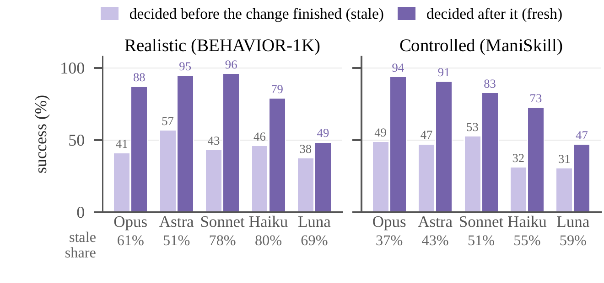

<h1 align="center">RoboLiveMem</h1>

<p align="center"><b>Is Robot Memory Solved When the World Does Not Wait?</b></p>

<p align="center">
Yunbei Zhang<sup>1,†,*</sup> &nbsp; Yuyou Zhang<sup>2,†</sup> &nbsp; Janet Wang<sup>1,†</sup> &nbsp; Ming Liu<sup>3</sup> &nbsp;
Yijiang Li<sup>4</sup> &nbsp; Yikai Wang<sup>2</sup> &nbsp; Weirui Ye<sup>5</sup> &nbsp; Ding Zhao<sup>2,*</sup> &nbsp; Jihun Hamm<sup>1,*</sup>
<br>
<sup>1</sup>Tulane &nbsp; <sup>2</sup>CMU &nbsp; <sup>3</sup>Amazon &nbsp; <sup>4</sup>UCSD &nbsp; <sup>5</sup>MIT
<br>
<sup>†</sup>Equal contribution &nbsp; <sup>*</sup>Co-corresponding authors
</p>

<p align="center">
<a href="https://robolivemem.github.io"><b>Project page</b></a> &nbsp;·&nbsp;
<a href="https://robolivemem.github.io/assets/RoboLiveMem.pdf"><b>Paper</b></a> &nbsp;·&nbsp;
<b>arXiv</b> (coming soon) &nbsp;·&nbsp;
<a href="#quickstart"><b>Quickstart</b></a> &nbsp;·&nbsp;
<a href="PROTOCOL.md"><b>Protocol</b></a>
</p>


Robot memory benchmarks pause the simulator while the model thinks, so whatever the robot remembers is still true when
it acts. **RoboLiveMem runs the same memory tasks twice: once with the world paused and once with the world running.**
People, robots and machines keep changing the scene during the agent's own deliberation, and every task mixes real
changes, harmless look-alikes and no change at all, so that no fixed strategy succeeds.

- **29 task families in three tiers**: 16 realistic BEHAVIOR-1K scenes, 8 MuJoCo kitchen families and 5 controlled
  ManiSkill tasks. **16 models, 34,176 episodes.**
- **Paused results hide the problem.** When a remembered object changes in a realistic scene, the 8 frontier Claude and
  GPT models succeed in 97% of episodes on average with the world paused and in 50% with it running. Claude Opus 5.5,
  which never fails when paused, succeeds in 44%.
- **Speed is not the fix.** Slower models do no worse, and at 2 s per decision every model still stays at least 36
  points below its paused success.
- **Models see the change but act on frames from before it ended.** Looking once more before acting (the *commit
  check*) recovers most of the realistic gap (Opus 62% → 97%), yet when identical objects are swapped several times,
  all nine models tested still lose points to memory.

## How it works

Each decision observes the world at time *t<sub>o</sub>*, thinks for *ℓ* seconds and starts its command at
*t<sub>c</sub> = t<sub>o</sub> + κ(ℓ)*: κ = 0 under the **paused** clock (current practice), κ = ℓ under the **live**
clock, and κ = L under a **fixed** clock that varies latency on its own. Each instance runs in three conditions:

| | Condition | What it measures |
|---|---|---|
| **P** | hidden state, paused clock | what current benchmarks report |
| **L** | hidden state, live clock | what a running world costs |
| **V** | visible twin, live clock (a sticker or an open lid keeps the state in view) | the same change, without having to remember it |

The live drop splits into an execution term and a memory term:
**S<sub>P</sub> − S<sub>L</sub> = (S<sub>P</sub> − S<sub>V</sub>) + (S<sub>V</sub> − S<sub>L</sub>)**, each with a 95% paired
bootstrap interval.


<p align="center">


</p>


## Quickstart

No GPU, no simulator and no API key: the `tabletop` family is a small 2-D version of *Grandpa's mug* (NumPy and Pillow
only) with the same protocol: event, look-alike and null seeds, a person who swaps mugs only while the robot holds
still, a safety interlock, visible twins and the commit check.

```bash
git clone https://github.com/RoboLiveMem/RoboLiveMem.git && cd RoboLiveMem
pip install -e .
python -m robolivemem                 # three reference policies, paused / live / visible twin, in about a second
```

```
stale  (12 seeds: event/decoy/null; 0.1 s)
  paused  S_P = 100.0%      live  S_L =  66.7%      visible twin  S_V =  66.7%
  live drop   S_P - S_L = +33.3 [+8.3, +58.3]
   execution  S_P - S_V = +33.3 [+8.3, +58.3]
   memory     S_V - S_L = +0.0 [+0.0, +0.0]
    event  P 4/4   L 0/4   V 0/4
    decoy  P 4/4   L 4/4   V 4/4
    null   P 4/4   L 4/4   V 4/4
```

A policy that fixes its plan at the first observation is perfect when the world waits and fails every event seed when
it does not. The `privileged` policy (reads the true state, waits while the person is at the table) solves every seed,
and `assume-change` fails every look-alike and null seed.


## Evaluate your agent

Every tier runs as an environment server with the same interface ([PROTOCOL.md](PROTOCOL.md)). The agent gets an
observation (instructions, text, camera images, world time) and answers with one command. Under the live clock the
world keeps moving for as long as the agent takes, whatever the agent is: a bare model, a model inside a harness such
as Claude Code or Codex, or your own system.

```bash
# 1. start an environment (the tabletop needs nothing else; the other tiers: see below)
python -m robolivemem.serve --port 8800 &

# 2. run an agent on the paper's episodes of that tier
python -m robolivemem.eval --tier tabletop --env http://127.0.0.1:8800 \
    --agent chat:anthropic:claude-haiku-5-5 --out results/tabletop_haiku.jsonl

# 3. tables: per task and per tier, for one or many runs
python -m robolivemem.report results/*.jsonl --out results/report
```

For the whole benchmark, start the servers of every tier (below), list them in a file like
[`envs.example.json`](envs.example.json) and run all tiers in one go: one row file per tier and one report.

```bash
python -m robolivemem.eval --tier all --envs envs.json --agent chat:anthropic:claude-haiku-5-5 --out results/haiku
```

| `--agent` | What runs |
|---|---|
| `chat:<provider>:<model>` | the paper's reference harness around a chat model: OpenAI, Anthropic, Gemini, Amazon Bedrock, or any OpenAI-compatible server (`OPENAI_BASE_URL`, e.g. your own model behind vLLM) |
| `my_agent.py:MyAgent` | your agent: a class with `act(obs) -> command` ([example](examples/my_agent.py)) |
| `cmd:<command>` | an external harness started once per episode; it acts through MCP tools (`python -m robolivemem.mcp`) or over HTTP ([example](examples/external_harness.py)) |
| `server:<policy>` | a reference policy inside the environment (privileged, stale, ...), to check an installation |

`eval` writes one row per episode (runs resume where they stopped) and prints the report. The tier summary has the
paper's quantities:

- `P` and `L`: success on event seeds, paused and live;
- `none`: live success when nothing changes;
- `L − P`: the live drop, with a 95% paired bootstrap interval;
- memory term `V − L`: on the families with a visible twin.

Report a result as **model + harness**, with its latency source, because the harness changes both what the model sees
and how long a decision takes (PROTOCOL.md, section 7).

Keys are read from environment variables only: copy `.env.example` to `.env`, fill in the providers you use, and run
`set -a; . ./.env; set +a`.

| Provider | Spec | Environment variables |
|---|---|---|
| OpenAI or any OpenAI-compatible server | `openai:<model>` | `OPENAI_API_KEY`, optional `OPENAI_BASE_URL` |
| Anthropic | `anthropic:<model>` | `ANTHROPIC_API_KEY` |
| Google Gemini | `gemini:<model>` | `GEMINI_API_KEY` |
| Amazon Bedrock | `bedrock:<model-id>` or a paper alias (`opus-5.5`, `gpt-6-astra`, `grok-4.7`, ...) | `AWS_BEARER_TOKEN_BEDROCK`, `AWS_REGION` |
| Offline test | `mock:<reply>` | none |

## The benchmark tiers

| Tier | Simulator | Families | Who changes the state | Start the environment | Needs |
|---|---|---|---|---|---|
| Realistic | BEHAVIOR-1K (OmniGibson, Isaac Sim) | 16 | people, robots, machines | one server per scene, in the BEHAVIOR-1K container ([`tiers/realistic`](tiers/realistic)) | NVIDIA RTX GPU, Docker, BEHAVIOR-1K assets (licensed by Stanford; you host them) |
| Semi-realistic | MuJoCo kitchen (Embodied Safety Exam) | 8 | a person at the counter | `python tiers/semi/server.py` ([`tiers/semi`](tiers/semi)) | CPU, or a GPU for EGL rendering |
| Controlled | ManiSkill (RoboMME scenes) | 5 | scripted object motions | `python tiers/controlled/server.py` ([`tiers/controlled`](tiers/controlled)) | CPU (Vulkan lavapipe) or GPU |
| Tabletop | 2-D, built in | 1 | a person | `python -m robolivemem.serve` | nothing |

The simulators and their assets are installed and hosted by you. This repository provides:

- the scenarios, scene files and task metadata;
- the clocks, actors and checks;
- the servers and the evaluation.

`python -m robolivemem.eval --tier <tier>` then runs the paper's episodes on them:

| Tier | Episodes |
|---|---|
| Realistic | event seeds paused and live, every seed live, twins on event and decoy seeds (about 330 episodes per agent) |
| Semi-realistic | 36 seeds × P, L, V (864) |
| Controlled | 40 seeds × P, L, V (600) |

## Release status

What this release contains and how it was checked (November 2026). The servers and the evaluation were run from a
clean copy of this repository on our machines.

| Part | Released | Checked |
|---|---|---|
| Protocol, model API, `eval` / `report` / `mcp` | yes | unit and end-to-end tests (`pytest -q tests`), every agent type on the tabletop |
| Tabletop (2-D) | yes | reference policies match the paper's validation pattern |
| Semi-realistic tier, 8 families | yes | server; reference policies (privileged solves every seed; stale fails event seeds live and passes decoy and null seeds); an API model with declared and with wall-clock latency |
| Controlled tier, 5 tasks | yes | server; the privileged policy; an API model with and without the commit check |
| Realistic tier, 16 scenes | yes | server in the BEHAVIOR-1K container; the stale reference policy (succeeds paused, fails event seeds live, passes decoy and null seeds); every tool; the fixed clock. Needs your own BEHAVIOR-1K install. |
| Claude Code / Codex harness (realistic) | yes | as used for the paper |
| Per-episode results, logs and videos of the paper | not yet: planned as a dataset release | – |
| Analysis scripts (stale / fresh timing on the simulator tiers, offline probe, failure taxonomy) | not yet | – |

With this release you can measure, for any model, harness or agent:

- every tier's main-table quantities (`P`, `L`, `none`, `L − P`, the memory term), per task and per tier;
- runs with the commit check (realistic, controlled);
- fixed-clock runs.

The stale / fresh analysis is available on the tabletop only for now.

## Repository layout

```
robolivemem/          the protocol, installable with pip
  protocol.py         environment server side (HTTP), observations and commands
  env.py              client: one interface for every tier
  agents.py           Agent base class, the reference chat harness, external harnesses
  eval.py, report.py  run the paper's episodes; per-task and per-tier tables
  mcp.py              the protocol as MCP tools for tool-using harnesses
  clock.py            paused, live and fixed clocks
  metrics.py          live drop, execution and memory terms, paired bootstrap
  commit.py           the commit check
  models.py           one chat interface for every provider (keys from environment variables)
  tabletop.py, serve.py   the 2-D family, in-process (python -m robolivemem) or as a server
tiers/realistic/      16 BEHAVIOR-1K scenes: scenario servers, tools, Claude Code / Codex harness
tiers/semi/           8 MuJoCo kitchen families and their server
tiers/controlled/     5 ManiSkill tasks on RoboMME scenes and their server
examples/             a custom agent and an external harness
PROTOCOL.md           what an agent receives and sends, the clock, reporting
tests/                pytest -q tests
```

## Citation

```bibtex
@misc{zhang2026robolivemem,
  title  = {RoboLiveMem: Is Robot Memory Solved When the World Does Not Wait?},
  author = {Zhang, Yunbei and Zhang, Yuyou and Wang, Janet and Liu, Ming and Li, Yijiang and Wang, Yikai and
            Ye, Weirui and Zhao, Ding and Hamm, Jihun},
  year   = {2026},
  url    = {https://robolivemem.github.io}
}
```

## License

Code: MIT (see `LICENSE`). BEHAVIOR-1K assets, ManiSkill, RoboMME and the Embodied Safety Exam keep their own licenses.
