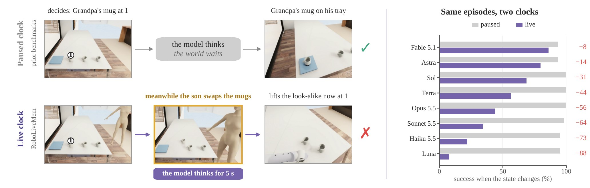
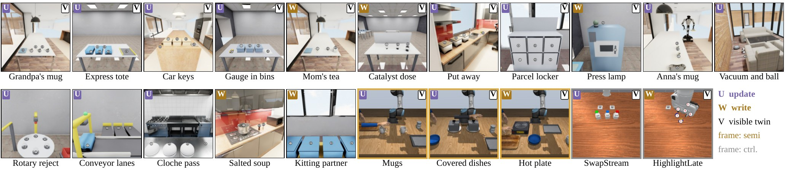
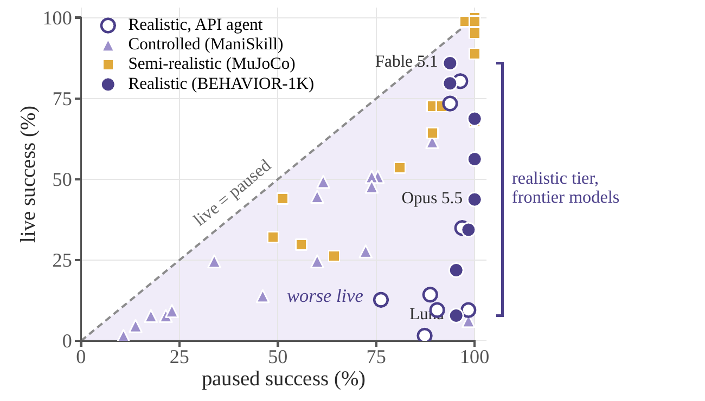
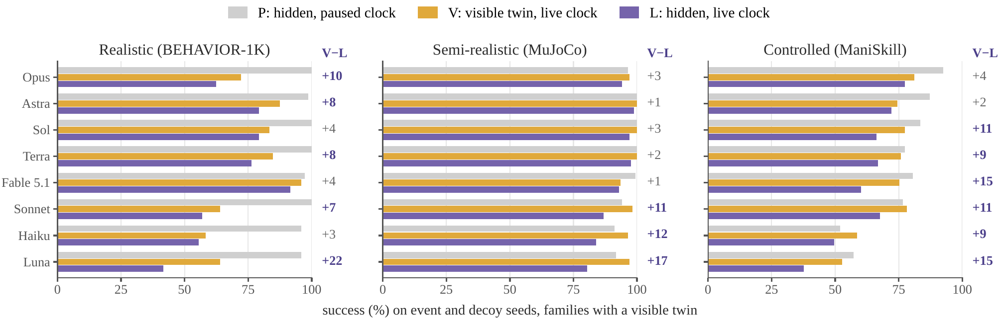
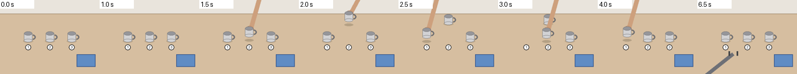

<h1 align="center">RoboLiveMem</h1>

<p align="center"><b>Is Robot Memory Solved When the World Does Not Wait?</b></p>

<p align="center">
Yunbei Zhang<sup>1,†,*</sup> &nbsp; Yuyou Zhang<sup>2,†</sup> &nbsp; Janet Wang<sup>1,†</sup> &nbsp; Ming Liu<sup>3</sup> &nbsp;
Yijiang Li<sup>4</sup> &nbsp; Yikai Wang<sup>2</sup> &nbsp; Weirui Ye<sup>5</sup> &nbsp; Ding Zhao<sup>2,*</sup> &nbsp; Jihun Hamm<sup>1,*</sup>
<br>
<sup>1</sup>Tulane &nbsp; <sup>2</sup>CMU &nbsp; <sup>3</sup>Amazon &nbsp; <sup>4</sup>UCSD &nbsp; <sup>5</sup>MIT
<br>
<sup>†</sup>Equal contribution &nbsp; <sup>*</sup>Co-corresponding authors
</p>

<p align="center">
<a href="https://robolivemem.github.io"><b>Project page</b></a> &nbsp;·&nbsp;
<b>Paper</b> (arXiv, coming soon) &nbsp;·&nbsp;
<a href="#quickstart"><b>Quickstart</b></a>
</p>



Robot memory benchmarks pause the simulator while the model thinks, so whatever the robot remembers is still true when
it acts. **RoboLiveMem runs the same memory tasks twice: once with the world paused and once with the world running.**
People, robots and machines keep changing the scene during the agent's own deliberation, and every task mixes real
changes, harmless look-alikes and no change at all, so that no fixed strategy succeeds.

- **29 task families in three tiers**: 16 realistic BEHAVIOR-1K scenes, 8 MuJoCo kitchen families and 5 controlled
  ManiSkill tasks. **16 models, 34,176 episodes.**
- **Paused results hide the problem.** When a remembered object changes in a realistic scene, the 8 frontier Claude and
  GPT models succeed in 97% of episodes on average with the world paused and in 50% with it running. Claude Opus 5.5,
  which never fails when paused, succeeds in 44%.
- **Speed is not the fix.** Slower models do no worse, and at 2 s per decision every model still stays at least 36
  points below its paused success.
- **Models see the change but act on frames from before it ended.** Looking once more before acting (the *commit
  check*) recovers most of the realistic gap (Opus 62% → 97%), yet when identical objects are swapped several times,
  all nine models tested still lose points to memory.

## How it works

Each decision observes the world at time *t<sub>o</sub>*, thinks for *ℓ* seconds and starts its command at
*t<sub>c</sub> = t<sub>o</sub> + κ(ℓ)*: κ = 0 under the **paused** clock (current practice), κ = ℓ under the **live**
clock, and κ = L under a **fixed** clock that varies latency on its own. Each instance runs in three conditions:

| | Condition | What it measures |
|---|---|---|
| **P** | hidden state, paused clock | what current benchmarks report |
| **L** | hidden state, live clock | what a running world costs |
| **V** | visible twin, live clock (a sticker or an open lid keeps the state in view) | the same change, without having to remember it |

The live drop splits into an execution term and a memory term:
**S<sub>P</sub> − S<sub>L</sub> = (S<sub>P</sub> − S<sub>V</sub>) + (S<sub>V</sub> − S<sub>L</sub>)**, each with a 95% paired
bootstrap interval.



<p align="center">


</p>



## Quickstart

No GPU, no simulator and no API key: the `tabletop` family is a small 2-D version of *Grandpa's mug* (NumPy and Pillow
only) with the same protocol: event, look-alike and null seeds, a person who swaps mugs only while the robot holds
still, a safety interlock, visible twins and the commit check.

```bash
git clone https://github.com/RoboLiveMem/RoboLiveMem.git && cd RoboLiveMem
pip install -e .
python -m robolivemem                 # three reference policies, paused / live / visible twin, in about a second
```

```
stale  (12 seeds: event/decoy/null; 0.1 s)
  paused  S_P = 100.0%      live  S_L =  66.7%      visible twin  S_V =  66.7%
  live drop   S_P - S_L = +33.3 [+8.3, +58.3]
   execution  S_P - S_V = +33.3 [+8.3, +58.3]
   memory     S_V - S_L = +0.0 [+0.0, +0.0]
  live decisive decisions: 100% stale; success stale 50% (8), fresh - (0)
    event  P 4/4   L 0/4   V 0/4
    decoy  P 4/4   L 4/4   V 4/4
    null   P 4/4   L 4/4   V 4/4
```

A policy that fixes its plan at the first observation is perfect when the world waits and fails every event seed when
it does not. The `privileged` policy (reads the true state, waits while the person is at the table) solves every seed,
and `assume-change` fails every look-alike and null seed.



## Run your own model

Keys are read from environment variables only. Copy `.env.example` to `.env`, fill in the providers you use, then:

```bash
set -a; . ./.env; set +a

python -m robolivemem --model anthropic:claude-haiku-5-5 --seeds 0-5        # Anthropic API
python -m robolivemem --model openai:<model> --seeds 0-5                    # OpenAI API
python -m robolivemem --model gemini:<model> --seeds 0-5                    # Gemini API
python -m robolivemem --model opus-5.5 --seeds 0-5                          # paper alias (Amazon Bedrock)
OPENAI_BASE_URL=http://localhost:8000/v1 \
python -m robolivemem --model openai:<served-model> --seeds 0-5             # any OpenAI-compatible server (vLLM, ...)

python -m robolivemem --model <spec> --commit         # with the commit check
python -m robolivemem --model <spec> --clock fixed:2  # charge 2 s per decision instead of the measured latency
python -m robolivemem --model <spec> --gif gifs/      # save every episode as an animated GIF
```

The same interface drives all three tiers. In Python:

```python
from robolivemem.models import Chat
from robolivemem import metrics

chat = Chat("anthropic:claude-haiku-5-5", max_tokens=1024)
text, meta = chat("You are a robot.", [("user", ["Which mug is Grandpa's?", rgb_image])])
meta["latency_s"]        # measured request time: what the live clock charges

rows = [...]             # one dict per episode: instance, condition ("P" | "L" | "V"), success[, stale]
print(metrics.report(rows))
```

| Provider | Spec | Environment variables |
|---|---|---|
| OpenAI or any OpenAI-compatible server | `openai:<model>` | `OPENAI_API_KEY`, optional `OPENAI_BASE_URL` |
| Anthropic | `anthropic:<model>` | `ANTHROPIC_API_KEY` |
| Google Gemini | `gemini:<model>` | `GEMINI_API_KEY` |
| Amazon Bedrock | `bedrock:<model-id>` or a paper alias (`opus-5.5`, `gpt-6-astra`, `grok-4.7`, ...) | `AWS_BEARER_TOKEN_BEDROCK`, `AWS_REGION` |
| Offline test | `mock:<reply>` | none |

## The benchmark tiers

| Tier | Simulator | Families | Who changes the state | Agent | Code |
|---|---|---|---|---|---|
| Realistic | BEHAVIOR-1K (OmniGibson, Isaac Sim) | 16 | people, robots, machines | tool-using agent: Claude Code, Codex or any API model | [`tiers/realistic`](tiers/realistic) |
| Semi-realistic | MuJoCo kitchen (Embodied Safety Exam) | 8 | a person at the counter | one call per step | [`tiers/semi`](tiers/semi) |
| Controlled | ManiSkill (RoboMME scenes) | 5 | scripted object motions | one call per step | [`tiers/controlled`](tiers/controlled) |

Each tier's README lists its requirements and the commands for the paper's runs. The realistic tier needs an NVIDIA RTX
GPU and the BEHAVIOR-1K assets; the other two run on a CPU (a GPU makes them faster).

## Repository layout

```
robolivemem/          the protocol, installable with pip
  clock.py            paused, live and fixed clocks
  metrics.py          live drop, execution and memory terms, stale / fresh split, paired bootstrap
  commit.py           the commit check
  models.py           one chat interface for every provider (keys from environment variables)
  tabletop.py         the 2-D quickstart family (python -m robolivemem)
tiers/realistic/      16 BEHAVIOR-1K scenes: scenario server, MCP tools, agents, aggregation
tiers/semi/           8 MuJoCo kitchen families
tiers/controlled/     5 ManiSkill tasks on RoboMME scenes
tests/                pytest -q tests
```

## Citation

```bibtex
@misc{zhang2026robolivemem,
  title  = {RoboLiveMem: Is Robot Memory Solved When the World Does Not Wait?},
  author = {Zhang, Yunbei and Zhang, Yuyou and Wang, Janet and Liu, Ming and Li, Yijiang and Wang, Yikai and
            Ye, Weirui and Zhao, Ding and Hamm, Jihun},
  year   = {2026},
  url    = {https://robolivemem.github.io}
}
```

## License

Code: MIT (see `LICENSE`). BEHAVIOR-1K assets, ManiSkill, RoboMME and the Embodied Safety Exam keep their own licenses.
